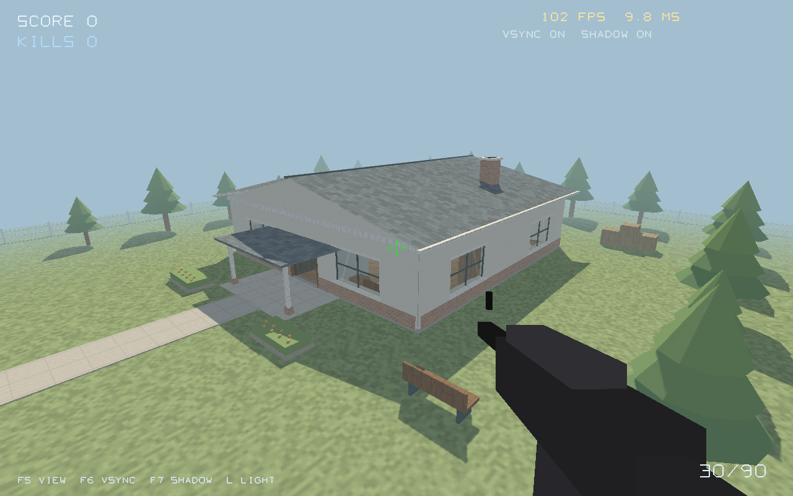
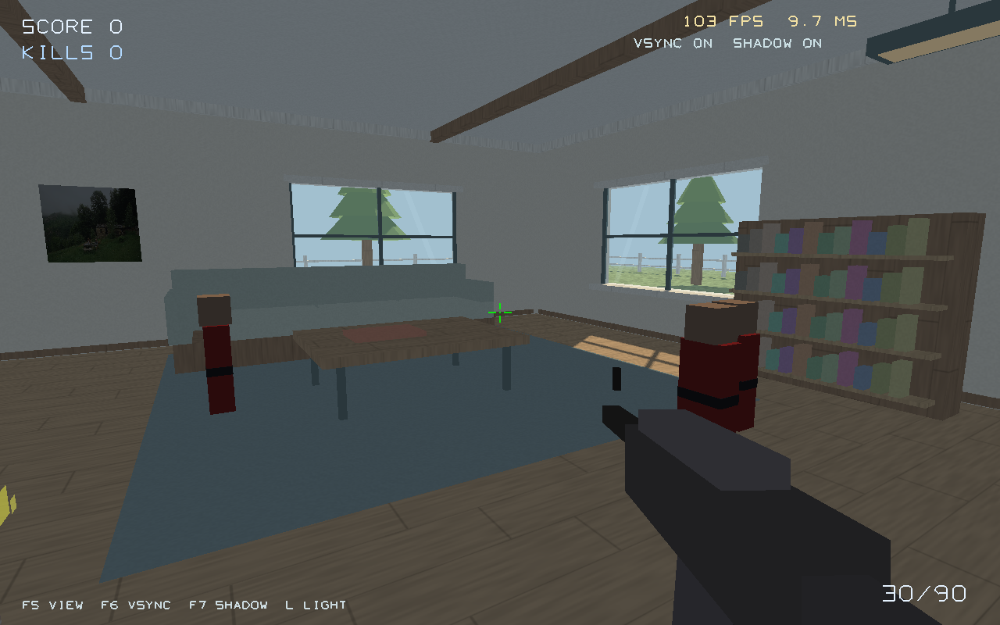

# CS House

一个使用 C++ 和 OpenGL 编写的 CS 风格第一人称房屋场景，用于观察室内外渲染效果、窗户采光，以及不同设置下的帧率和整帧耗时。

你可以在房屋与庭院之间自由移动，观察阳光穿过窗户形成的光影，也可以使用步枪射击靶子、操作室内灯光。项目使用 CMake 构建，当前验证平台为 Linux。

## 场景预览

**房屋外观与庭院**



**关闭室内灯后的窗户采光**



## 功能特性

| 类别 | 已实现内容 |
| --- | --- |
| 房屋外部 | 厚墙、双坡屋顶、烟囱、门廊、常开大门 |
| 庭院 | 道路、花坛、树木、围栏、长椅和木箱 |
| 客厅 | 沙发、地毯、茶几、书架、挂画和壁炉 |
| 厨房与餐厅 | 橱柜、水槽、炉灶、餐桌和椅子 |
| 卧室 | 带门洞的隔墙、床、枕头、床头柜和衣柜 |
| 窗户与采光 | 四面墙共八扇真实窗洞、窗台、窗框、透明玻璃及太阳阴影 |
| 第一人称交互 | 鼠标观察、键盘移动、碰撞检测、灯开关 |
| 射击 | 连发、后坐力、枪口闪光、换弹、身体/爆头判定、得分和靶子重生 |
| 音效与粒子 | 程序化枪声、脚步声、换弹声、命中声、火焰和火花 |
| 性能观察 | FPS、整帧耗时、垂直同步开关、太阳阴影开关 |

## 快速开始

### 环境要求

- Linux 桌面环境及可用的 OpenGL 显卡驱动。
- 支持 C++17 的编译器。
- CMake；使用下列 `cmake -S/-B` 命令需要 CMake 3.13 或以上。
- OpenGL 3.0 或以上的兼容上下文、GLU、GLFW3、libpng 和 pkg-config。

部分武器和 HUD 绘制仍使用固定管线，运行时需要兼容上下文，不能使用仅提供 Core Profile 的上下文。当前构建目标不依赖 GLM 或 GLEW。

### 安装依赖

Ubuntu / Debian：

```bash
sudo apt-get update
sudo apt-get install build-essential cmake pkg-config \
  libglfw3-dev libgl1-mesa-dev libglu1-mesa-dev libpng-dev
```

### 构建与启动

在项目根目录执行：

```bash
cmake -S . -B build -DCMAKE_BUILD_TYPE=Release
cmake --build build -j
./build/CSGODemo
```

默认窗口大小为 1280 × 800，初始位置在房屋入口内侧。大门位于房屋南侧（+Z）中央，转身即可走向门廊和庭院；也可以按 **F5** 直接切换到室外总览。

纹理目录由 CMake 写入程序，因此也可以从 `build` 目录运行 `./CSGODemo`。移动源码目录后需要重新配置并构建。音效通过运行时加载 `libasound.so.2` 实现，无需安装 ALSA 开发包；无法打开音频设备时自动静音。

## 操作说明

| 按键 | 功能 |
| --- | --- |
| W / S / A / D | 前进 / 后退 / 左移 / 右移 |
| 鼠标移动 | 转动视角 |
| 左 Ctrl | 加速移动 |
| Space / 左 Shift | 上升 / 下降，仍参与碰撞检测 |
| 鼠标左键 | 射击，按住连发 |
| R | 换弹 |
| E | 靠近并瞄准右墙开关时开关室内灯 |
| L | 直接开关室内灯 |
| F5 | 切换入口室内视角与室外总览 |
| F6 | 切换垂直同步 |
| F7 | 切换太阳阴影 |
| Esc | 释放或重新捕获鼠标 |
| Q | 退出程序 |

观察窗户采光时，可以先切换到客厅视角，再按 **L** 关闭室内灯。玻璃允许光线透过，但仍阻挡玩家和子弹；当前不支持玻璃破碎。

## 命令行参数

| 参数 | 作用 | 默认行为 |
| --- | --- | --- |
| `--view NAME` | 选择 `entrance`、`exterior`、`interior` 或 `bedroom` 视角 | `entrance` |
| `--no-audio` | 跳过音频初始化 | 启用音频，失败时静音 |
| `--no-vsync` | 关闭垂直同步 | 开启 |
| `--no-shadows` | 关闭太阳阴影采样 | 开启 |
| `--lights-off` | 关闭室内灯 | 开启 |
| `--frames N` | 渲染正整数 N 帧后自动退出 | 持续运行 |
| `--capture PATH` | 退出前将最后一帧保存为 PNG | 不截图 |

单独指定 `--capture` 时默认运行三帧。截图目录需要事先存在。固定帧数模式使用固定随机种子，并在启动时释放鼠标，便于重复检查。

例如，打开客厅视角并只保留日光：

```bash
./build/CSGODemo --view interior --lights-off
```

保存室外、室内采光与卧室截图：

```bash
mkdir -p build/screenshots
./build/CSGODemo --no-audio --frames 90 --view exterior \
  --capture build/screenshots/exterior.png
./build/CSGODemo --no-audio --frames 90 --view interior --lights-off \
  --capture build/screenshots/daylight.png
./build/CSGODemo --no-audio --frames 90 --view bedroom \
  --capture build/screenshots/bedroom.png
```

## 性能观察

窗口标题和右上角显示 FPS、整帧耗时、垂直同步及阴影状态。统计约每半秒更新一次，刚启动时可能暂时显示为零。

建议使用 Release 构建，保持相同窗口尺寸和视角，关闭垂直同步后观察稳定帧率，再通过 **F7** 对比阴影采样开销：

```bash
./build/CSGODemo --no-audio --no-vsync --view exterior
```

也可以进行固定帧数的运行检查：

```bash
./build/CSGODemo --no-audio --no-vsync --frames 3000 --view exterior
```

这里的毫秒数是整帧耗时，包含 CPU 工作、GPU 等待与缓冲交换，并非 GPU 独立计时。程序目前不输出基准分数、统计报告或 CSV。阴影图在初始化时缓存，F7 对比的是阴影采样开关，不包含每帧重新生成阴影图的成本。

## 技术实现

- **场景绘制**：房屋、家具和庭院使用 VBO，按十种材质批量绘制。
- **材质**：使用 GLSL 程序化生成木纹、砖墙、瓦片、草地等表面纹理；挂画使用仓库内的 PNG 图片。
- **太阳光照**：使用 4096 × 4096 深度图和 3 × 3 PCF 过滤。墙壁、屋顶、家具及窗框遮挡阳光，窗洞允许光线进入室内。
- **玻璃**：在不透明场景之后，按距离排序进行透明混合，关闭深度写入；玻璃不写入太阳深度图。
- **移动碰撞**：主要实体使用包围盒，屋顶补充斜面检测；移动分成小步，降低慢帧时穿墙的可能性。
- **射击遮挡**：对场景三角形和玻璃进行射线检测，比较场景与靶子的命中距离。
- **资源与兼容性**：场景使用着色器，现有武器、HUD 等保留兼容管线绘制；音效通过动态加载 ALSA 输出。

太阳和建筑为静态场景，阴影图只在初始化时生成。动态靶子、火花和火焰不向这张阴影图投影。当前版本也不包含多人联网、昼夜循环或实时全局光照。

## 测试

默认构建包含几何测试，运行时无需创建窗口：

```bash
ctest --test-dir build --output-on-failure
```

测试覆盖入口与卧室通路、墙体/玻璃/家具/屋顶碰撞、八扇窗洞、射击遮挡、室外地面命中，以及重复构建几何的一致性。

前面的截图命令可用于渲染检查，需要桌面显示服务及可用的 OpenGL 驱动。固定帧数运行结束时会检查 OpenGL 错误；着色器编译失败、截图失败或检测到渲染错误时返回非零退出码。

已在 Linux、NVIDIA GeForce RTX 3080、OpenGL 4.6 环境验证。Windows 和 macOS 尚未验证，当前源码中的 Linux OpenGL 头文件和动态库接口也需要针对目标平台适配。

## 项目结构

```text
csgohome/
├── CMakeLists.txt                 # 构建与测试配置
├── README.md
├── LICENSE
├── docs/images/                   # README 场景截图
├── include/
│   ├── HouseScene.h               # 场景、碰撞和射线检测接口
│   └── ...                       # 旧相机、房间和渲染器接口
├── src/
│   ├── main.cpp                  # 窗口、输入、玩法、音频、HUD 和主循环
│   ├── HouseScene.cpp            # 房屋几何、材质、采光及透明玻璃
│   └── ...                       # 旧模块实现
├── res/                          # 挂画等 PNG 资源
└── tests/
    └── house_geometry_test.cpp    # 无窗口几何检查
```

当前可执行文件只编译 `src/main.cpp` 和 `src/HouseScene.cpp`。`Camera.cpp`、`Room.cpp`、`Renderer.cpp` 等旧类暂未接入构建，修改当前场景应从 `HouseScene` 开始。

## 常见问题

| 现象 | 排查方法 |
| --- | --- |
| GLFW 初始化失败或无法创建窗口 | 确认在可访问桌面显示服务的会话中运行，并检查驱动是否提供 OpenGL 兼容上下文；普通无图形 SSH 会话不能直接显示窗口。 |
| 找不到 PNG、GLFW 或 GLU | 安装上述开发依赖，然后重新执行 CMake 配置。 |
| 找不到图片资源 | 检查源码中的 `res` 目录；若移动了源码，重新配置并编译。 |
| 鼠标被窗口捕获 | 按 Esc 释放，按 Q 退出。 |
| 没有声音或音频设备报错 | 确认系统播放设备可用，或使用 `--no-audio` 静音运行。 |
| 帧率接近显示器刷新率 | 按 F6 或使用 `--no-vsync` 关闭垂直同步。 |
| 窗口右上角暂时显示零帧率 | 等待半秒以上；短帧数运行可能在第一次统计更新前结束。 |

## 许可证

本项目采用 [Apache License 2.0](LICENSE)。
